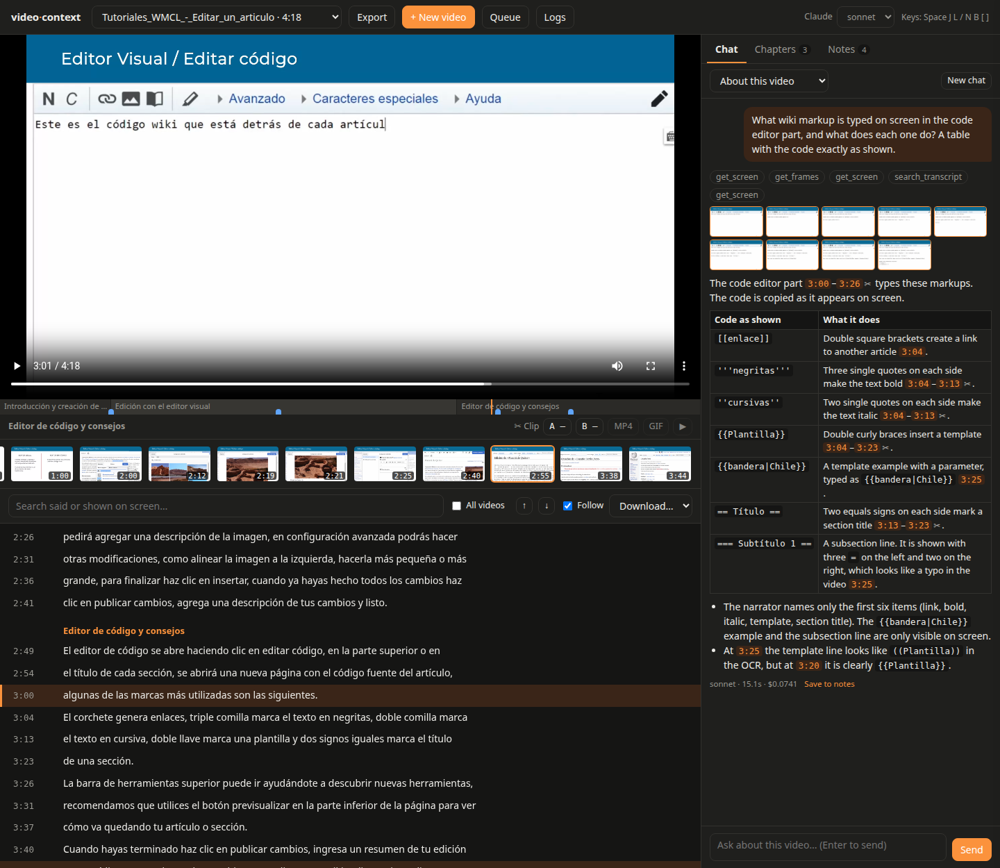
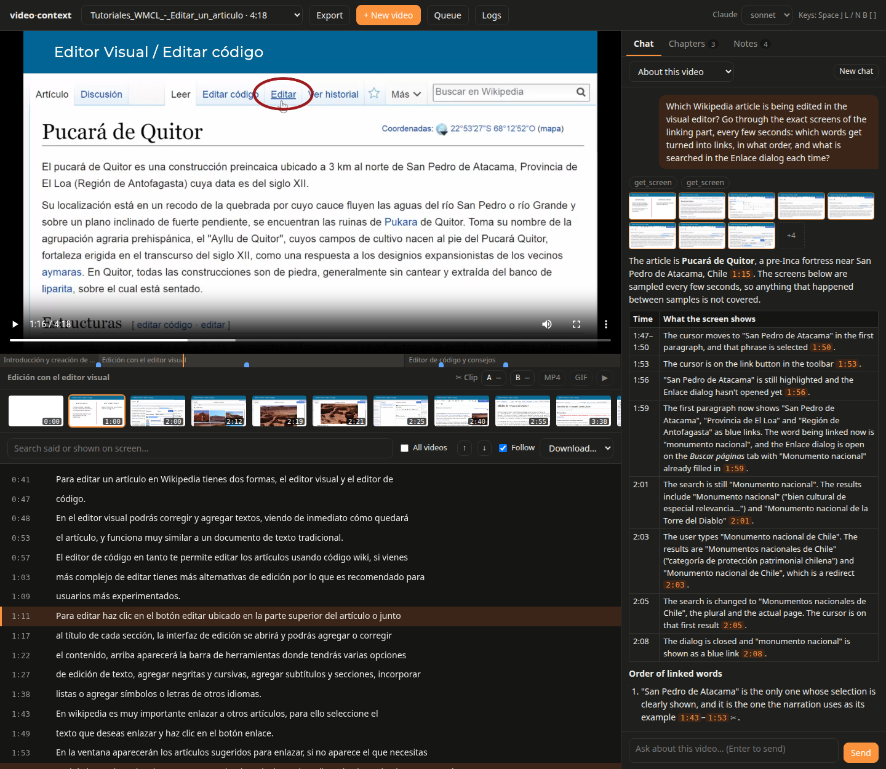
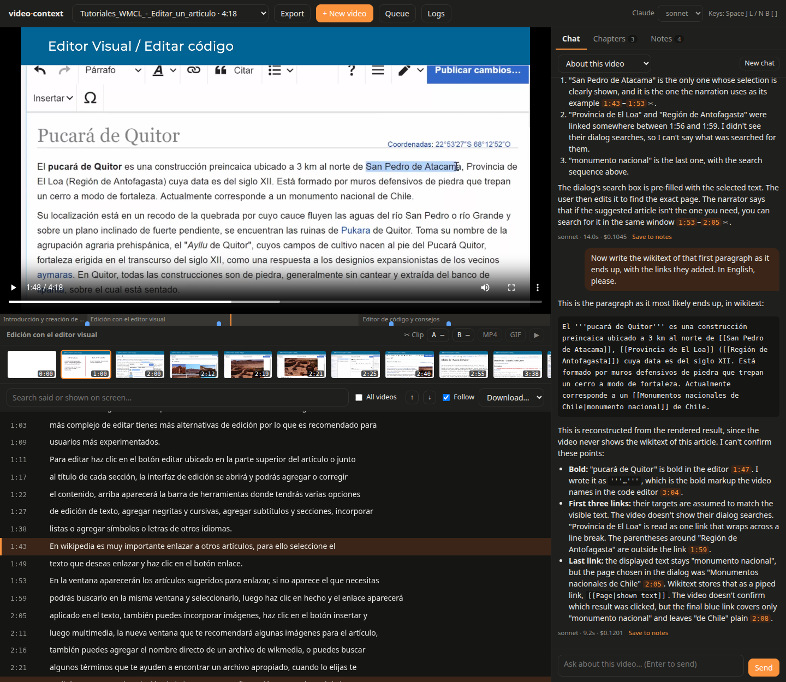
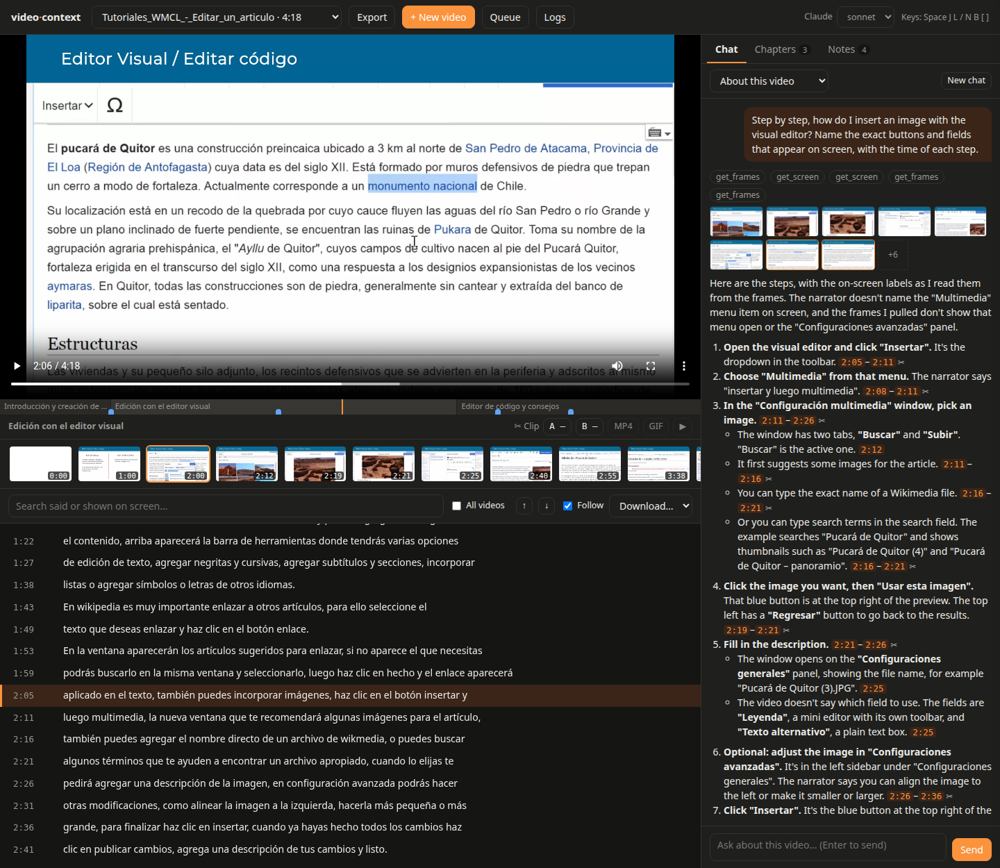
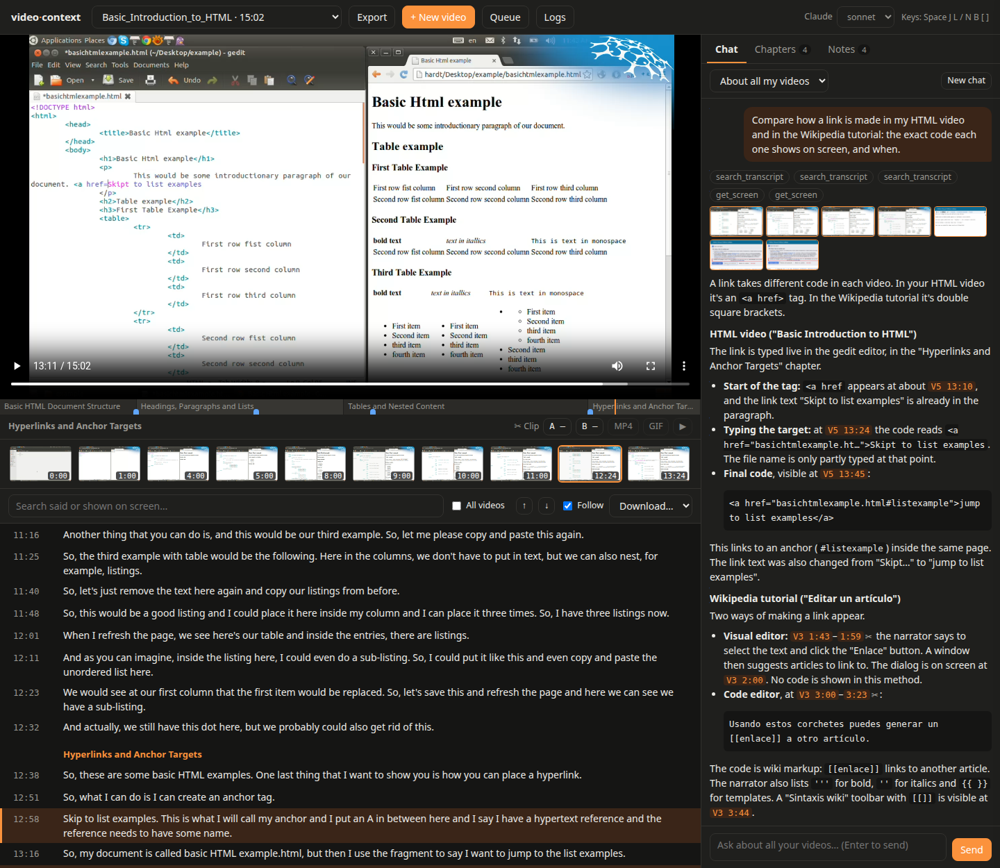

# Asking Claude about a video

The page's **Chat** sends your question to Claude (the [`claude` CLI](https://claude.com/claude-code),
with your login and the model picked at the top) together with what video-context knows about
the video. Claude reads the transcript, searches it, and **looks at the screen** — the key
frames, and the exact screen at any moment, read with OCR. So it can answer about what is
*shown*, not only what is *said*: code being typed, buttons, dialogs, the text of a page.

The examples below are real questions and answers (Claude Sonnet) about
[Tutoriales WMCL - Editar un artículo](https://commons.wikimedia.org/wiki/File:Tutoriales_WMCL_-_Editar_un_art%C3%ADculo.webm),
a 4-minute tutorial by Wikimedia Chile and Canzu Animation Studios
([CC BY-SA 4.0](https://creativecommons.org/licenses/by-sa/4.0/)) on editing Wikipedia, narrated
in Spanish. The questions are in English: Claude answers in the language you write in. Each
answer was checked against the video.

## What Claude gets

| | |
| --- | --- |
| In the prompt | The video's title and length, its whole transcript (when it fits; else Claude reads it with the tools), its chapters and your notes. |
| `search_transcript` | Where something is said, or shown on screen (the text of the key frames). |
| `get_transcript` | The transcript of a time range. |
| `get_frames` | The key frames around a time, as images, with their text. |
| `get_screen` | The exact screen at any times, taken from the video file, as images with their text. |
| `search_videos` | Where something is said or shown in any of your videos. |

Nothing else: no shell, no files, no internet. The tools Claude used show above each answer,
then the frames it looked at (exact screens with an orange border; click one to go there).
Every time it cites (`3:04`, `3:00–3:26`) is a link that seeks the player, and a range has a ✂
that marks it as a clip.

## Code on the screen

> What wiki markup is typed on screen in the code editor part, and what does each one do? A
> table with the code exactly as shown.



In the tutorial the code is typed live, a line at a time, while the narrator lists the marks.
Typing is no scene change, so no key frame holds it: Claude took the **exact screens** of that
part with `get_screen` and read them.

| Code as shown | What it does |
| --- | --- |
| `[[enlace]]` | Double square brackets create a link to another article [3:04]. |
| `'''negritas'''` | Three single quotes on each side make the text bold [3:04–3:13]. |
| `''cursivas''` | Two single quotes on each side make the text italic [3:04–3:13]. |
| `{{Plantilla}}` | Double curly braces insert a template [3:04–3:23]. |
| `{{bandera\|Chile}}` | A template example with a parameter [3:25]. |
| `== Título ==` | Two equals signs on each side mark a section title [3:13–3:23]. |
| `=== Subtítulo 1 ==` | A subsection line. It is shown with three `=` on the left and two on the right, which looks like a typo in the video [3:25]. |

It also says what is only on the screen — the narrator never mentions `{{bandera|Chile}}` or
the subsection — and spots a typo in the video. 15 s, $0.07.

## What happens on the screen, second by second

> Which Wikipedia article is being edited in the visual editor? Go through the exact screens of
> the linking part, every few seconds: which words get turned into links, in what order, and
> what is searched in the Enlace dialog each time?



The narration only says "select the text and click the link button". Claude names the article
from the screen (**Pucará de Quitor**) and walks through twelve exact screens:

| Time | What the screen shows |
| --- | --- |
| 1:47–1:50 | The cursor moves to "San Pedro de Atacama" in the first paragraph, and that phrase is selected. |
| 1:59 | "San Pedro de Atacama", "Provincia de El Loa" and "Región de Antofagasta" are now blue links. "monumento nacional" is being linked, with the Enlace dialog open and "Monumento nacional" filled in. |
| 2:03 | The user types "Monumento nacional de Chile". The results are "Monumentos nacionales de Chile" and "Monumento nacional de Chile", which is a redirect. |
| 2:05 | The search is changed to "Monumentos nacionales de Chile", the actual page. |
| 2:08 | The dialog is closed and "monumento nacional" is shown as a blue link. |

(An excerpt.) It says what it could not see, too: two of the links were made between two
screens it looked at. 14 s, $0.10.

**Asking for exact screens matters.** The first time, without "go through the exact screens",
Claude looked at two key frames and gave only the last link. When a question is about what
happens on screen, ask it to look closely.

## Rebuilding what is shown

A follow-up, in the same conversation:

> Now write the wikitext of that first paragraph as it ends up, with the links they added. In
> English, please.



```wikitext
El '''pucará de Quitor''' es una construcción preincaica ubicado a 3 km al norte de [[San Pedro de Atacama]], [[Provincia de El Loa]] ([[Región de Antofagasta]]) cuya data es del siglo XII. Está formado por muros defensivos de piedra que trepan un cerro a modo de fortaleza. Actualmente corresponde a un [[Monumentos nacionales de Chile|monumento nacional]] de Chile.
```

The video never shows this paragraph's wikitext: Claude rebuilt it from the rendered page —
the bold title, the blue links — and from what it had seen in the dialog, which is why the
last link is piped (`[[page|shown text]]`). It lists what it assumed. No tool was needed: a
follow-up builds on what Claude already looked at (asked again in a new conversation, the
answer was poorer). 9 s. (Without "In English, please", this follow-up once came back in
Spanish, the video's language.)

## A guide from a video

> Step by step, how do I insert an image with the visual editor? Name the exact buttons and
> fields that appear on screen, with the time of each step.



From six key frames and eight exact screens, Claude writes the steps with the labels as they
appear — **Insertar**, **Configuración multimedia**, the **Buscar** and **Subir** tabs,
**Usar esta imagen**, **Regresar**, **Leyenda**, **Texto alternativo**, **Configuraciones
avanzadas** — each with its time, and says which ones the narrator never names. 21 s, $0.09.
**Save to notes** under an answer keeps it with the video; **Export Markdown** (Notes tab)
takes it out.

## Across your videos

With **About all my videos**:

> Compare how a link is made in my HTML video and in the Wikipedia tutorial: the exact code each
> one shows on screen, and when.



Two videos, two languages, one answer. Claude finds the moments with `search_transcript` in each
video, reads the exact screens, and cites each one with its video (`V5 13:45` is the HTML
screencast, `V3 3:00` the tutorial; the links open that video there):

```html
<a href="basichtmlexample.html#listexample">jump to list examples</a>
```

```
Usando estos corchetes puedes generar un [[enlace]] a otro artículo.
```

| | HTML [V5 13:45] | Wikipedia [V3 3:00–3:23] |
| --- | --- | --- |
| Syntax | `<a href="URL">text</a>` | `[[article]]` |
| Target | You type the file or URL, plus an optional `#anchor`. | The article name is the target. |

It also follows the HTML link being typed — `<a href` at 13:10, the file name half typed at
13:24, done at 13:45 — and notes that its text changed from "Skipt to list examples" to "jump
to list examples". 18 s, $0.08.

## Tips

- **Say when the answer is on the screen**: "what is typed on screen", "go through the exact
  screens", "name the buttons as shown". Claude then looks instead of relying on the narration.
- **Name a moment or a range** ("at 3:15", "between 1:45 and 2:10"), or select lines of the
  transcript and press **Ask about this**.
- **Follow up** in the same conversation: Claude keeps what it read and saw. **New chat**
  starts over.
- **Ask for a format**: a table, a checklist, code, a summary per chapter.
- **Ask for the language** if an answer drifts to the video's: "in English, please". (Claude
  Code's own `language` setting applies too.)
- **About all my videos** for questions across meetings or trainings ("in which meeting did
  they decide the deadline?").
- **Pick the model** at the top: Sonnet for most questions; Opus for long or subtle ones;
  Haiku for quick ones.

## Limits

- Claude sees what video-context gives it: the transcript (as good as whisper's), the key
  frames, the exact screens it asks for, and their OCR (which can misread small or stylized
  text). It does not watch the video continuously: something that happens between two screens
  it looked at can be missed, and it says so when it knows.
- A rebuilt or inferred answer (like the wikitext above) is an inference; Claude says what it
  assumed. Check what matters against the video: every citation is a link to the moment.
- Exact screens need the video file where it was processed (or imported). Without it, only
  the key frames remain.
- Each answer shows its time and the cost the `claude` CLI reports (at API prices: here
  between $0.07 and $0.12 with Sonnet); on a Claude subscription it counts toward its usage
  limits instead. Both are in the logs too.
