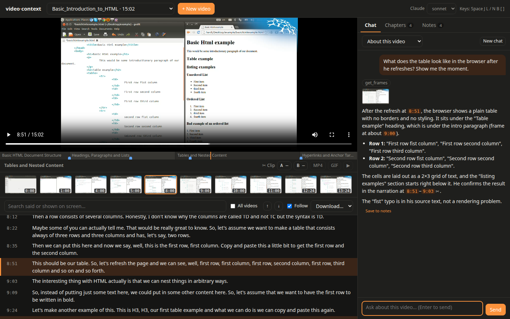
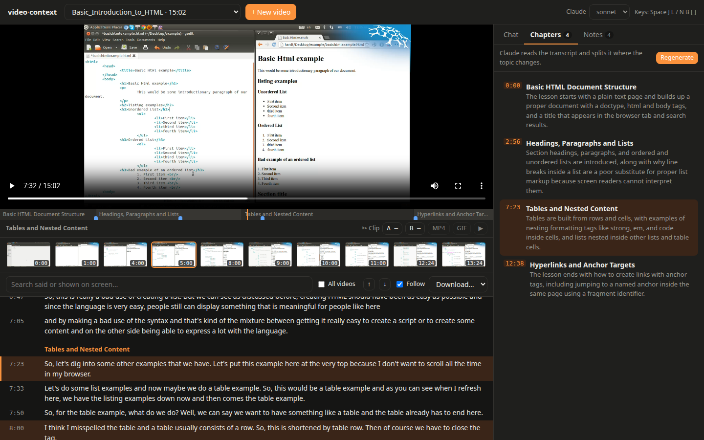
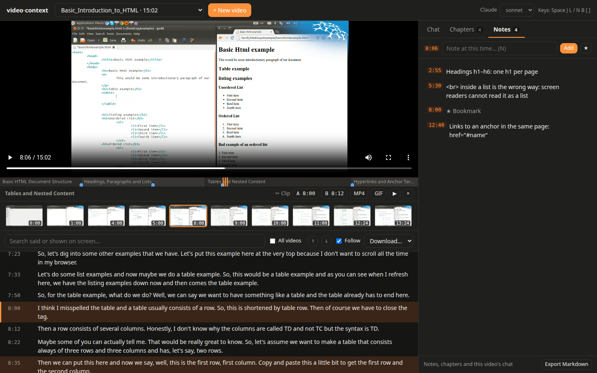
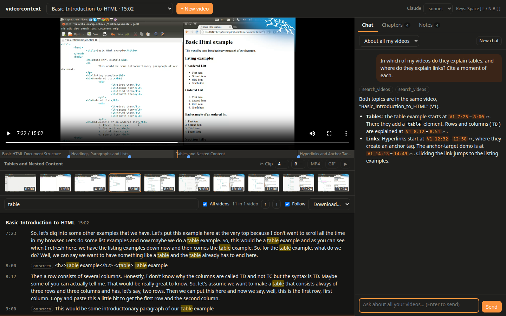
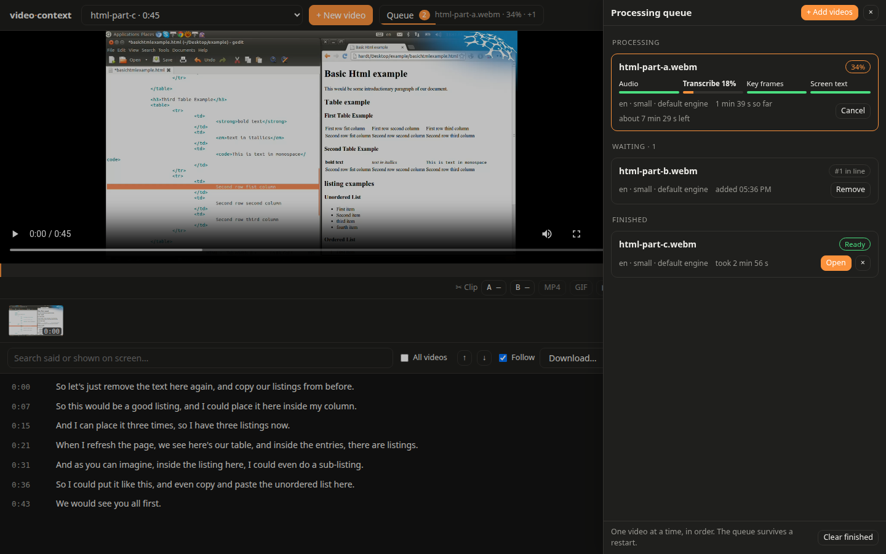

# The web page

```bash
npx -p @lalohao/video-context video-context-ui --open
```

It opens `http://localhost:4317` (`--port` picks another) and lists the videos already
processed, newest first. The screenshots below show
[the screencast of the example](../examples/README.md),
[Basic Introduction to HTML](https://commons.wikimedia.org/wiki/File:Basic_Introduction_to_HTML.webm)
(© Renepick, [CC BY-SA 3.0](https://creativecommons.org/licenses/by-sa/3.0/); the screenshots
are under the same license), with real answers from Claude Sonnet.

## Watch, read and ask



- The **transcript** follows the player: the line being said is highlighted and kept in view
  (scroll away and it waits a few seconds; untick **Follow** to stop it). Click a line, a
  key frame or the bar under the player to go there.
- **Search** finds words said or shown on screen, accents and case aside: lines that do not
  match fade out, hits show as yellow ticks on the bar, and `Enter` / `Shift+Enter` go from
  one to the next. **Download…** saves the transcript as Markdown, SRT or JSON.
- **Ask Claude** runs the [`claude` CLI](https://claude.com/claude-code) with your login and
  the model chosen at the top (sonnet, opus, fable, haiku). Claude gets the whole transcript
  (or reads it with the tools, when it is long), the chapters and your notes, and this
  package's MCP tools: it searches, and looks at the key frames when the question is about
  the screen. The tools it used and the frames it looked at show above the answer. Every
  time it cites is a link to that moment, and a range (`[7:50–8:35]`) has a ✂ that marks it
  as a clip. Follow-up questions continue the same conversation; **New chat** starts over.
- Select lines of the transcript to **ask about them**, keep them as a **note**, or **clip**
  them.

Claude has no other tools: no shell and no file edits. It runs in the video's cache folder,
so no project's `CLAUDE.md` applies; your own Claude Code settings do (its answers follow
your `language` setting, for example).

## Chapters



**Generate** asks Claude to split the video where the topic changes: a short title and a
one-sentence summary for each part, in the language spoken in the video. They are saved next
to the transcript (`chapters.json`) and show on the bar under the player, as headings in the
transcript and in the **Chapters** tab; the current one is named under the player.

## Notes and clips



- **Notes**: type one at the current time (`N` to jump there), bookmark the moment with ★
  (`B`), or press **Save to notes** under an answer. Click a note's text to edit it. They show
  as blue marks on the bar, are saved next to the video (`notes.json`), and **Export
  Markdown** writes them with the chapters and the video's conversation.
- **Clips**: set the start and the end with **A** and **B** (or `[` and `]`), a ✂ in an
  answer, or a selection in the transcript. ▶ plays the clip; **MP4** and **GIF** (up to
  30 s) download it, made with ffmpeg once and kept in the video's `clips/` folder. An audio
  file gives an M4A.

## All your videos



- Tick **All videos** to search every processed video: the hits are grouped by video, and a
  click opens that video at that moment.
- Choose **About all my videos** to ask across the library (*"in which meeting did they decide
  the deadline?"*). Claude finds the videos with the `search_videos` tool and cites each moment
  with the video's label, `[V2 0:19]`: the link opens that video there.

## Processing videos: the queue



**+ New video** adds videos to the queue: files dropped on the dialog (several at once; they
are copied to `~/.cache/video-context/uploads`) or paths on this computer, one per line, with
the spoken language, the whisper model and the engine. Videos are processed one at a time, in
order, since whisper already uses every core.

The **Queue** button at the top (or `Q`) says how many are left and how far the current one
is, and opens the queue:

- The video **processing** shows each step — the audio (or a model download), the
  transcription, the key frames and the text on screen — with its progress, the time so far
  and an estimate of the time left. **Cancel** stops it.
- Videos **waiting** show their place in line: **Move to front** or **Remove**.
- **Finished** ones: **Open** a ready video, **Retry** a failed one (its error is shown) or
  **Process again** a canceled one. **Clear finished** empties that part of the list.

A video already processed is ready at once. A message says when each video is ready (and
opens it if none is open). The queue is kept in `~/.cache/video-context/queue.json`: if the
page's server stops, the video that was processing starts again, and the rest wait their turn.

## Keys

| Key | Does |
| --- | --- |
| `Space` / `K` | Play or pause |
| `J` / `L` (or `←` / `→`) | Back or forward 5 seconds |
| `/` | Search |
| `N` | Write a note at this time |
| `B` | Bookmark this time |
| `[` / `]` | Clip start / end at this time |
| `Q` | Open or close the queue |

## Privacy

The server listens only on 127.0.0.1, refuses requests made by other sites, and serves only
processed videos, their frames and their results. The chat history lives in your browser
(`localStorage`); chapters and notes live next to each video's results.
