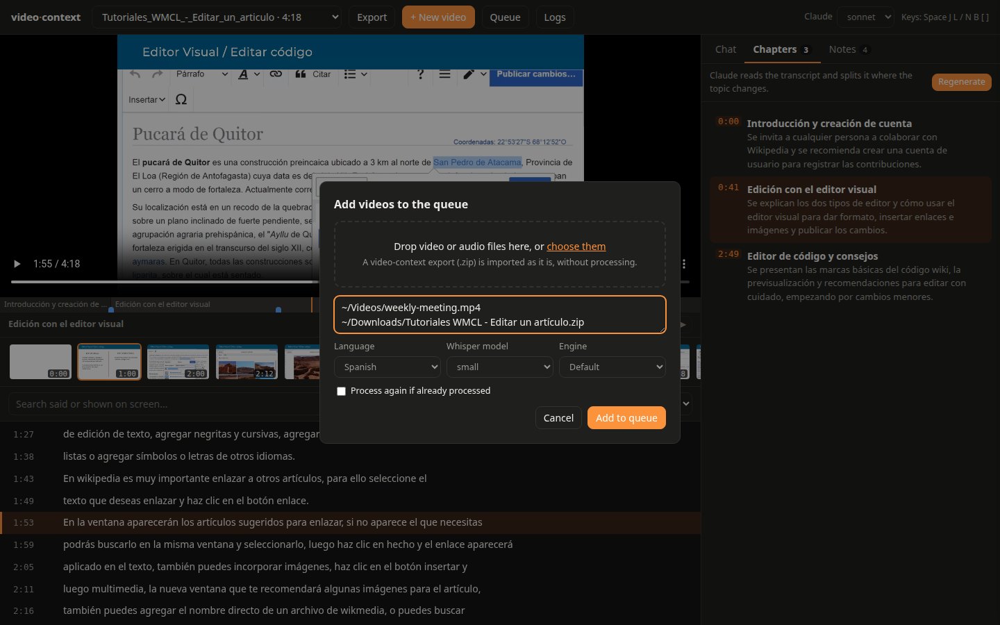
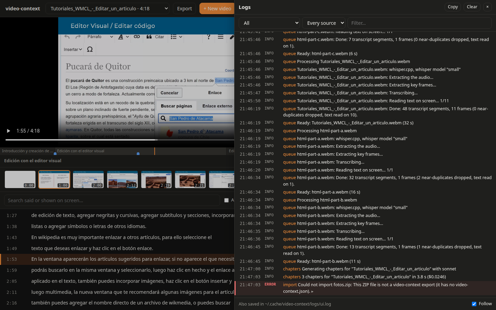
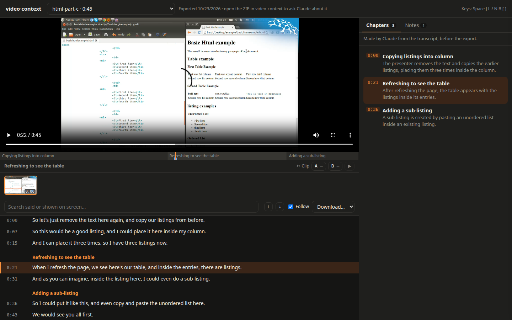

# The web page

```bash
npx -p @lalohao/video-context video-context-ui --open
```

It opens `http://localhost:4317` (`--port` picks another) and lists the videos already
processed, newest first.

The screenshots below show two videos from Wikimedia Commons, with real results and real
answers from Claude Sonnet; each screenshot is under the license of the video it shows:

- [Basic Introduction to HTML](https://commons.wikimedia.org/wiki/File:Basic_Introduction_to_HTML.webm)
  (the screencast of [the example](../examples/README.md); © Renepick,
  [CC BY-SA 3.0](https://creativecommons.org/licenses/by-sa/3.0/)), in English, and pieces of it.
- [Tutoriales WMCL - Editar un artículo](https://commons.wikimedia.org/wiki/File:Tutoriales_WMCL_-_Editar_un_art%C3%ADculo.webm)
  (© Wikimedia Chile and Canzu Animation Studios,
  [CC BY-SA 4.0](https://creativecommons.org/licenses/by-sa/4.0/)), in Spanish.

## Watch, read and ask


- The **transcript** follows the player: the line being said is highlighted and kept in view
  (scroll away and it waits a few seconds; untick **Follow** to stop it). Click a line, a
  key frame or the bar under the player to go there.
- **Search** finds words said or shown on screen, accents and case aside: lines that do not
  match fade out, hits show as yellow ticks on the bar, and `Enter` / `Shift+Enter` go from
  one to the next. **Download…** saves the transcript as Markdown, SRT or JSON.
- **Ask Claude** runs the [`claude` CLI](https://claude.com/claude-code) with your login and
  the model chosen at the top (sonnet, opus, fable, haiku). Claude gets the whole transcript
  (or reads it with the tools, when it is long), the chapters and your notes, and this
  package's MCP tools: it searches, and looks at the screen — the key frames, and the exact
  screen at any moment (`get_screen`), to read what is typed between them. Examples of what
  to ask, with real answers: **[claude.md](claude.md)**. The tools it used and the frames it looked at show above the answer. Every
  time it cites is a link to that moment, and a range (`[7:50–8:35]`) has a ✂ that marks it
  as a clip. Follow-up questions continue the same conversation; **New chat** starts over.
- Select lines of the transcript to **ask about them**, keep them as a **note**, or **clip**
  them.

Claude has no other tools: no shell and no file edits. It runs in the video's cache folder,
so no project's `CLAUDE.md` applies; your own Claude Code settings do (its answers follow
your `language` setting, for example).

## Chapters


**Generate** asks Claude to split the video where the topic changes: a short title and a
one-sentence summary for each part, in the language spoken in the video. They are saved next
to the transcript (`chapters.json`) and show on the bar under the player, as headings in the
transcript and in the **Chapters** tab; the current one is named under the player.

## Notes and clips


- **Notes**: type one at the current time (`N` to jump there), bookmark the moment with ★
  (`B`), or press **Save to notes** under an answer. Click a note's text to edit it. They show
  as blue marks on the bar, are saved next to the video (`notes.json`), and **Export
  Markdown** writes them with the chapters and the video's conversation.
- **Clips**: set the start and the end with **A** and **B** (or `[` and `]`), a ✂ in an
  answer, or a selection in the transcript. ▶ plays the clip; **MP4** and **GIF** (up to
  30 s) download it, made with ffmpeg once and kept in the video's `clips/` folder. An audio
  file gives an M4A.

## All your videos


- Tick **All videos** to search every processed video: the hits are grouped by video, and a
  click opens that video at that moment.
- Choose **About all my videos** to ask across the library (*"in which meeting did they decide
  the deadline?"*). Claude finds the videos with the `search_videos` tool and cites each moment
  with the video's label, `[V2 0:19]`: the link opens that video there.

## Adding videos



**+ New video** takes files dropped on the dialog (several at once; they are copied to
`~/.cache/video-context/uploads`) or paths on this computer, one per line, with the spoken
language, the whisper model and the engine. A video or audio file goes to the processing
queue; a video-context export (`.zip`, see [below](#export-and-import)) is imported as it is,
with nothing to process. A recorder's `.json` (the meeting's title and who spoke when, see
[Who said what](../README.md#who-said-what)) goes with its video: drop both, or give both
paths. It is uploaded first and read when the video is processed; it is never queued itself.
A video processed before its `.json` was next to it shows **Process again** in the queue, to
add the speakers.

**Process again** (at the top) processes the open video anew: the dialog opens with its file,
language, whisper model and engine — confirm, or pick a bigger model for a better transcript.
Its chapters and notes are kept. A file already processed is ready at once (tick **Process again** to
do it anyway).

## The queue


Videos are processed one at a time, in order, since whisper already uses every core. The
**Queue** button at the top (or `Q`) says how many are left and how far the current one is
(`Tutoriales_WMCL… · 85% · +2`), and opens the queue:

- The video **processing** shows its four steps — the audio (or a model download), the
  transcription, the key frames, the text on screen — each with its progress, the time so far
  and an estimate of the time left. **Cancel** stops it.
- Videos **waiting** show their place in line: **Move to front** or **Remove**.
- **Finished** ones: **Open** a ready one, **Retry** a failed one (its error is shown, and
  **Logs** opens its entries), **Process again** a canceled one. **Clear finished** empties
  that part of the list.

A message says when each video is ready, and opens it if none is open. The queue is kept in
`~/.cache/video-context/queue.json`: closing the page changes nothing, and if the server
stops, the video that was processing starts again when it starts, and the rest wait their turn.

### When processing stops halfway

A video that stopped halfway — the server crashed or was closed, or it was canceled — does not
start over. The steps it finished stay in its folder until it is done (the audio, the
transcript, the key frames and their text), and the next attempt only does the rest:

```
Tutoriales_WMCL….webm was processing when the server stopped: it starts again from the steps it finished
Tutoriales_WMCL….webm: Audio kept from the last attempt.
Tutoriales_WMCL….webm: Transcribing…
Tutoriales_WMCL….webm: Key frames kept from the last attempt.
Tutoriales_WMCL….webm: Text on screen kept from the last attempt.
```

They are kept only for the same language, whisper model and engine; with others it starts
over. A transcription stopped in the middle is done again from its start (whisper cannot go
on from where it was). If the server crashed, the tools it left running (ffmpeg, whisper,
tesseract) are stopped when it starts again, after checking they are still those tools.

## Logs



The **Logs** button at the top (or `Shift+L`) shows what the server did and what failed:
the steps of each video, chapters, chat questions and answers (with their time and cost),
clips, uploads, exports and imports. A red count on the button says how many errors are new.
Filter by level, by source or by text; an entry with details — Claude's answer, a tool's
error output — opens with a click, and **Copy** takes the entries shown (to paste in an
issue). Errors in the page link to their entries (**See the logs**). Everything is also
written to `~/.cache/video-context/logs/ui.log`, which outlives the server.

When something fails, the message says why, and what to do when it can be fixed:

| Message | What to do |
| --- | --- |
| `Failed to authenticate: OAuth session expired…` | Sign in to Claude again: `claude auth login` in a terminal. |
| `…rate limit…` / `…usage limit…` | Wait a moment, or pick another model at the top. |
| `ffprobe failed … Invalid data found when processing input` | The file is not a video or audio file ffmpeg reads, or it is damaged. |
| `Missing: …` | A tool is not installed: run `video-context --doctor`. |
| `This ZIP file is not a video-context export` | Only ZIP files made with **Export** can be imported. |

## Export and import



**Export** (at the top) downloads the open video as one ZIP file, to hand to someone who then
needs nothing processed — no whisper, no waiting. The archive holds one folder:

| File | What it is |
| --- | --- |
| `index.html` | This page with the video's data inside: open it from the folder, in any browser. Nothing to install, no server. |
| `video.<ext>` | The video. |
| `transcript.md`, `.srt`, `.json` | The transcript with its times (the `.srt` works in any player). |
| `frames/` | The key frames. |
| `chapters.json`, `notes.json` | The chapters and the notes. |
| `manifest.json`, `video-context.json` | What video-context needs to import it back. |
| `README.txt` | How to open it and how to import it. |

The ZIP is written as it downloads (a large video is not copied first); files past 4 GB are
fine (ZIP64), and any unzip tool opens it.

**The exported page** plays the video with the transcript following it, its subtitles (CC),
the key frames, the chapters and the search, just as here. Notes can be added there (they stay
in that browser; **Export Markdown** takes them out), and clips marked and played. What needs
this server is not there: asking Claude, the queue, the logs, generating chapters,
downloading clips. It opens with a double click: no server, no internet.

**Importing**: **+ New video** and drop the ZIP file (or type its path). The video is copied
to `~/.cache/video-context/imports`, and its transcript, frames, chapters and notes go where
processing would have put them: it is ready at once, never processed again, and Claude can be
asked about it. Importing the same export twice does nothing the second time. Only the files
an export has are taken from the archive, and only to their own places.

## Where things are

Everything stays in `~/.cache/video-context` (`VIDEO_CONTEXT_HOME` picks another folder):

| Path | What it is |
| --- | --- |
| `videos/<id>/` | A processed video's results: `manifest.json`, `transcript.*`, `frames/`, and from the page `chapters.json`, `notes.json`, `clips/`, `screens/` (`unfinished.json` while it is not done; `playable.webm`, a seekable copy, for a browser's recording without duration nor index). |
| `queue.json` | The processing queue. |
| `logs/ui.log` | The log (moved to `ui.log.1` past 5 MB). |
| `uploads/` | Files dropped on the page, processed from there. |
| `imports/` | The videos of imported exports. |

## Keys

| Key | Does |
| --- | --- |
| `Space` / `K` | Play or pause |
| `J` / `L` (or `←` / `→`) | Back or forward 5 seconds |
| `/` | Search |
| `N` | Write a note at this time |
| `B` | Bookmark this time |
| `[` / `]` | Clip start / end at this time |
| `Q` | Open or close the queue |
| `Shift+L` | Open or close the logs |

## Privacy

The server listens only on 127.0.0.1, refuses requests made by other sites, and serves only
processed videos, their frames and their results. The chat history lives in your browser
(`localStorage`); chapters and notes live next to each video's results.
