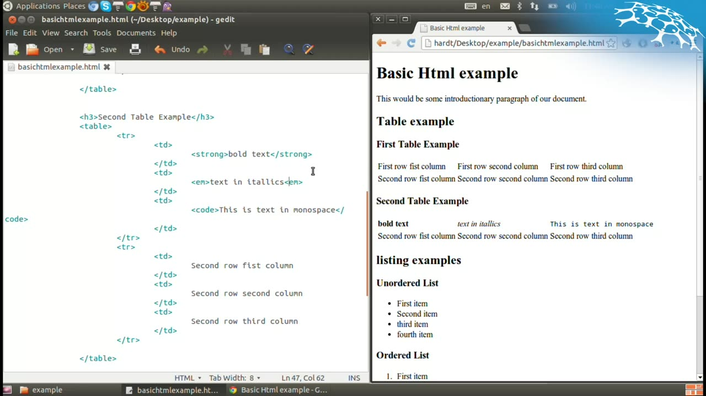

# Example: a narrated HTML screencast

This walkthrough uses a public, freely licensed video:
**[Basic Introduction to HTML](https://commons.wikimedia.org/wiki/File:Basic_Introduction_to_HTML.webm)**
by Renepick, on Wikimedia Commons, licensed
[CC BY-SA 3.0](https://creativecommons.org/licenses/by-sa/3.0/) — a 15-minute screencast
where the author writes an HTML page in a text editor and explains it.

The transcript excerpts and the frame below are derived from that video and are shared under
the same license (CC BY-SA 3.0, © Renepick). The video itself is not included in this repository.

It is a good test because much of what matters is **on screen and never said**: the code.

## 1. Download and process

```bash
curl -L -o Basic_Introduction_to_HTML.webm \
  https://upload.wikimedia.org/wikipedia/commons/5/58/Basic_Introduction_to_HTML.webm

npx -p @lalohao/video-context video-context Basic_Introduction_to_HTML.webm --language en
```

```
"Basic_Introduction_to_HTML" — 15:02, 74 segments, 10 frames
Transcript: ~/.cache/video-context/videos/1b89ee92869de617/transcript.md
Frames:     ~/.cache/video-context/videos/1b89ee92869de617/frames
Video id:   1b89ee92869de617
Dropped 6 near-duplicate frames.
```

A screencast of a text editor changes little from one minute to the next: 16 frames were
sampled and 6 dropped as near-identical.

## 2. The transcript

`transcript.md` starts like this:

> **[0:00]** Yeah, hello. In this lesson I will teach you some basic HTML which should be pretty
> straightforward and most of you guys already probably know this. So, in this folder I created
> an HTML file which I can open with my browser and I can open with my text editor …

## 3. Searching what is said and what is shown

`search_transcript` with the query `table` returns both:

```
Said:
[7:23–8:00] So, let's dig into some other examples that we have. … Let's do some list examples
and now maybe we do a table example. …
[8:12–8:51] Then a row consists of several columns. Honestly, I don't know why the columns are
called TD and not TC but the syntax is TD. …
[9:09–9:40] … So, now we have to call this our second table example and what we can do here,
for example, we can say, well, this should be written bold.

On screen:
[8:00] <h2>Table example</h2>
</table>
Table example
[10:00] </table>
<h3>Second Table Example</h3>
```

## 4. Looking at a frame

`get_frames` with `at: "11:00"` returns the frame and the text read on it:



```
</table>
<h3>Second Table Example</h3>
<table>
<tr>
<td>
<strong>bold text</strong>
</td>
<td>
<em>text in itallics<em>
</td>
…
```

The OCR is approximate (note `itallics`, as typed in the video, and the occasional misread
character). It is good enough to *find* the moment; the agent then reads the image itself.

## 5. Asking an agent

With the MCP server added to Claude Code
(`claude mcp add video-context -- npx -y -p @lalohao/video-context video-context-mcp`):

> Process ~/Downloads/Basic_Introduction_to_HTML.webm (English). Write the final HTML file the
> author builds, as it appears on screen at the end, and list the concepts he explains with the
> minute of each.

The agent calls `process_video`, follows it with `video_status`, reads the transcript with
`get_transcript`, finds the code with `search_transcript`, and checks the last screens with
`get_frames` — citing a minute for everything it takes from the video.
